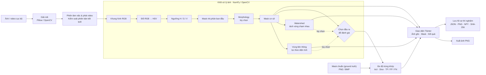

# HSV Color Segmentation

[](https://www.python.org/)
[](https://docs.python.org/3/library/tkinter.html)
[](https://numpy.org/)
[](https://opencv.org/)
[](docs/verification.md)
[](specs/002-object-separation-evaluation/tasks.md)

Ứng dụng desktop độc lập dùng để học tập, trình diễn và đánh giá phân đoạn màu bằng
ngưỡng HSV. Toàn bộ workflow hoạt động offline: mở ảnh hoặc video, điều chỉnh sáu ngưỡng,
phân tích vùng liên thông, thử tách vùng chạm nhau bằng Watershed, đối chiếu với ground truth,
sau đó xuất PNG hoặc lưu một experiment có thể tái lập.

## Đây là gì?

HSV Color Segmentation là công cụ trực quan hóa thuật toán phân đoạn màu theo ba thành phần:

- **Hue (H)** — góc màu trong khoảng `[0°, 360°)`;
- **Saturation (S)** — độ bão hòa trong khoảng `[0%, 100%]`;
- **Value (V)** — độ sáng trong khoảng `[0%, 100%]`.

Ứng dụng dành cho sinh viên và giảng viên cần một công cụ dễ giải thích, có kết quả xác định,
không phụ thuộc dịch vụ mạng và có đủ bằng chứng kiểm thử cho báo cáo học thuật.

## Điểm nổi bật

- Mở ảnh **PNG, JPEG, BMP** và video **MP4, AVI** được decoder cục bộ hỗ trợ.
- Hiển thị đồng thời **Original**, **Binary Mask** và **Segmented Result**.
- Sáu ngưỡng HSV dạng số nguyên, cập nhật tự động và hỗ trợ hue vòng qua `0°`.
- Preset khởi đầu cho Red, Yellow, Green và Blue.
- Lấy mẫu trực tiếp từ một pixel hoặc vùng ROI để đề xuất khoảng HSV.
- Morphology tùy chọn với Opening, Closing hoặc Opening + Closing.
- Phân tích connected components/contour với area, centroid, bounding box và bộ lọc diện tích tối thiểu.
- Watershed tùy chọn để thử tách các vùng chạm nhau; HSV mask vẫn là đầu vào cốt lõi.
- Nạp ground-truth PNG/BMP để đo chất lượng của `baseline`, `components` hoặc `watershed`
  bằng IoU/Dice và xem trực quan TP/FP/FN.
- Chế độ overlay, so sánh mask trước/sau morphology và thống kê tỷ lệ pixel được chọn.
- Histogram H/S/V cho frame hiện tại với marker ngưỡng liên tục.
- Zoom, Fit, cuộn và pan độc lập trên từng vùng preview.
- Xuất mask và kết quả dưới dạng PNG lossless ở đúng độ phân giải nguồn.
- Lưu experiment gồm UUID, nguồn, frame, threshold, ghi chú, SHA-256 và các artifact liên quan.
- Xử lý nền có revision để loại bỏ kết quả cũ khi người dùng chỉnh nhanh.
- Giao diện dark scientific workspace có độ tương phản cao, hỗ trợ bàn phím và hoạt động offline.

## Pipeline xử lý

GitHub render sơ đồ này trực tiếp bằng Mermaid:



Các nhánh phân tích vùng, Watershed và đánh giá ground truth là tùy chọn. `baseline` luôn là
mask HSV sau morphology; target không khả dụng sẽ không âm thầm rơi về baseline.

### Cách đọc pipeline

Pipeline đi từ trái sang phải:

1. **Nạp dữ liệu:** Pillow đọc ảnh; OpenCV đọc video và đưa từng frame về ảnh RGB.
2. **Quản lý phiên:** ứng dụng nhớ nguồn, frame và lần chỉnh tham số hiện tại. Nếu một tác vụ
   cũ hoàn thành sau khi bạn đã đổi ngưỡng, kết quả cũ bị loại bỏ thay vì ghi đè giao diện.
3. **Tạo mask HSV:** frame RGB được đổi sang HSV. Mỗi pixel nằm trong cả ba khoảng H, S và V
   sẽ thành màu trắng (`255`) trên mask; pixel còn lại thành màu đen (`0`).
4. **Làm sạch mask:** morphology có thể loại đốm nhỏ hoặc lấp lỗ. Kết quả của bước này là
   `baseline` — đầu ra chính luôn có, kể cả khi các tính năng nâng cao đang tắt.
5. **Phân tích tùy chọn:** vùng liên thông dùng để đếm/lọc vùng theo diện tích; Watershed dùng
   để thử tách các vật thể đang chạm nhau. Hai nhánh này cùng nhận `baseline`, không thay thế
   thuật toán HSV ban đầu.
6. **Đánh giá tùy chọn:** chọn một trong ba đầu ra `baseline`, `components` hoặc `watershed`,
   rồi so sánh với mask chuẩn để tính IoU/Dice và xác định pixel đúng, chọn thừa, bỏ sót.
7. **Xem và lưu:** giao diện hiển thị ảnh gốc, mask và kết quả; người dùng có thể xuất PNG
   hoặc lưu toàn bộ cấu hình, metric và hash thành một experiment có thể tái lập.

### Tutorial: tách một vật thể theo màu

Ví dụ cần tách một vật thể màu đỏ khỏi ảnh nền:

1. Nhấn **Open Image…** và chọn ảnh. Kiểm tra ba khung **Original**, **Mask** và **Result**.
2. Chọn preset **Red** làm điểm bắt đầu. Màu đỏ nằm ở hai đầu vòng Hue nên ứng dụng có thể
   dùng khoảng vòng qua `0°`, chẳng hạn `350°..10°`.
3. Chỉnh H để giữ đúng tông đỏ; tăng S để loại vùng xám/trắng; chỉnh V nếu vùng tối hoặc vùng
   chói đang bị chọn sai. Quan sát Mask cập nhật sau mỗi lần chỉnh.
4. Nếu mask có nhiều chấm nhiễu, bật **Opening**. Nếu vật thể có lỗ nhỏ bên trong, dùng
   **Closing**. So sánh trước/sau morphology để tránh làm mất chi tiết thật.
5. Bật **Object Analysis**, đặt **Minimum area** để bỏ các vùng quá nhỏ. Bảng thống kê sẽ cho
   biết diện tích, tâm và bounding box của từng vùng còn lại.
6. Chỉ bật **Watershed** khi hai vật thể chạm nhau cần được tách. Nếu ứng dụng báo
   `not applied`, mask HSV cơ sở vẫn được giữ nguyên và có thể tiếp tục sử dụng.
7. Nếu có mask chuẩn, chọn target cần kiểm tra rồi nhấn **Load** trong phần
   **Ground-truth evaluation**. Mask chuẩn phải là PNG/BMP cùng kích thước với ảnh nguồn.
8. Đọc IoU/Dice: điểm càng gần `1` thì kết quả càng giống mask chuẩn. Bật **TP/FP/FN** để xem
   màu xanh lá là vùng đúng, đỏ là vùng chọn thừa và xanh dương là vùng bị bỏ sót.
9. Khi kết quả đạt yêu cầu, dùng **Save Mask…**, **Save Result…** hoặc
   **Record Experiment…**. Experiment phù hợp khi cần đưa kết quả vào báo cáo hoặc chạy lại.

Nếu không có ground truth, bạn vẫn có thể quan sát và xuất kết quả, nhưng tỷ lệ
**Selected pixels** chỉ cho biết mask phủ bao nhiêu phần trăm ảnh — đó không phải độ chính xác.

## Kiến trúc mã nguồn

| Layer | Trách nhiệm |
|---|---|
| `processing/` | Thuật toán thuần trên mảng NumPy; không đọc file và không phụ thuộc GUI |
| `io/` | Đọc ảnh/video, xuất PNG và ghi experiment |
| `application/` | Session, playback, background worker và kiểm soát revision |
| `gui/` | Theme, controls, preview, histogram, dialog và controller Tk |

## Yêu cầu

- Windows 10/11 x64
- Python 3.11 có Tcl/Tk
- [uv](https://docs.astral.sh/uv/)

Ứng dụng không yêu cầu tài khoản, database, web server hoặc kết nối mạng khi chạy.

## Cài đặt và chạy

```powershell
git clone <repository-url>
cd "HSV Segmentation"
uv sync --locked --extra test
uv run hsv
```

Entrypoint tương đương:

```powershell
uv run hsv-segmentation
```

## Sử dụng nhanh

Thanh điều khiển bên trái đặt **HSV**, **Refine** và **Analyze** liên tiếp trong
cùng một sidebar cuộn dọc, giúp quan sát toàn bộ workflow mà không phải chuyển tab.
Analyze dùng panel phẳng, cô đọng cho object analysis, Watershed, thống kê và
evaluation; các tham số nâng cao chỉ khả dụng khi tính năng tương ứng được bật.
Toàn bộ workspace dùng dark theme có độ tương phản cao để quan sát ảnh và mask
thuận tiện hơn.

1. Chọn **Open Image…** hoặc **Open Video…**.
2. Điều chỉnh Lower/Upper của Hue, Saturation và Value trong inspector bên trái.
3. So sánh ba preview Original, Mask và Result.
4. Dùng **Pick Color** với chế độ Pixel hoặc ROI nếu cần một khoảng HSV khởi đầu.
5. Bật Morphology khi cần loại nhiễu nhỏ hoặc lấp các lỗ nhỏ trong mask.
6. Mở **Show Histogram** để đối chiếu phân bố màu với các ngưỡng đang dùng.
7. Dùng **Save Mask…**, **Save Result…** hoặc **Record Experiment…** để lưu kết quả.
8. Bật **Object Analysis** để xem thống kê; chỉnh **Minimum area** để loại vùng nhiễu.
9. Bật **Watershed** khi cần thử tách vùng chạm nhau. Nếu marker không đủ, ứng dụng giữ mask HSV và hiển thị lý do.
10. Dùng **Load Truth…** với mask PNG/BMP cùng kích thước để xem IoU/Dice. “Selected pixels” chỉ là coverage, không phải accuracy.

Hue cho phép khoảng vòng qua gốc đỏ. Ví dụ `H = 350°..10°` chọn cả phần cuối và phần
đầu của vòng màu. Các khoảng S và V luôn phải có lower không lớn hơn upper.

## Ground-truth evaluation dùng để làm gì?

Ground truth là **mask tham chiếu đúng** do con người gán nhãn hoặc được tạo từ một nguồn
đáng tin cậy. Ứng dụng so sánh mask mà thuật toán dự đoán với mask này để trả lời câu hỏi:
“phần foreground được chọn có trùng với đối tượng cần tách hay không?”. Tính năng này hữu ích để:

- đo chất lượng phân đoạn thay vì chỉ nhìn tỷ lệ pixel được chọn;
- tìm vùng chọn thừa (**false positive**) và vùng bị bỏ sót (**false negative**);
- so sánh công bằng ba đầu ra `baseline`, `components` và `watershed` trên cùng một nhãn;
- điều chỉnh ngưỡng HSV/morphology và lưu bằng chứng định lượng có thể tái lập.

| Chỉ số | Ý nghĩa |
|---|---|
| **IoU** | Tỷ lệ phần giao trên phần hợp: `TP / (TP + FP + FN)` |
| **Dice** | Mức chồng lấp, nhấn mạnh phần giao: `2TP / (2TP + FP + FN)` |
| **TP** | Pixel foreground được dự đoán đúng |
| **FP** | Pixel nền bị chọn nhầm |
| **FN** | Pixel foreground bị bỏ sót |

IoU và Dice nằm trong `[0, 1]`; càng gần `1` thì hai mask càng trùng nhau. Hai mask cùng
rỗng được ghi rõ trạng thái `both_empty` và nhận điểm `1`; nếu chỉ một mask rỗng thì điểm là
`0`. Overlay **TP/FP/FN** dùng màu xanh lá/đỏ/xanh dương để chỉ ra lỗi nằm ở đâu.

### Cách đánh giá

1. Mở ảnh, hoặc tạm dừng video tại đúng frame cần đánh giá.
2. Trong **Analyze → Ground-truth evaluation**, chọn target:
   - `baseline`: mask HSV sau morphology;
   - `components`: mask sau lọc connected components theo diện tích;
   - `watershed`: hợp các vùng Watershed khi bước tách được áp dụng thành công.
3. Chọn ngưỡng chuyển ground truth thành mask nhị phân. Quy tắc là `gray > threshold`.
4. Nhấn **Load** và chọn PNG/BMP lossless có cùng kích thước với ảnh nguồn. Ảnh RGB phải
   là grayscale (ba kênh bằng nhau); alpha bị bỏ qua và ảnh không được tự resize.
5. Đọc IoU/Dice, bật **TP/FP/FN** nếu muốn xem confusion overlay, rồi ghi experiment nếu
   cần lưu prediction, normalized truth, metric và hash làm bằng chứng.

Ground-truth evaluation **không tự tạo nhãn, không tự cải thiện kết quả và không biến HSV
thresholding thành object detection**. Nếu chưa nạp ground truth thì ứng dụng chỉ báo coverage,
không tuyên bố accuracy. Ground truth được giữ khi chỉnh tham số trên cùng ảnh/frame để metric
được tính lại, nhưng bị xóa khi đổi nguồn, chuyển frame hoặc restart video nhằm tránh so sánh
nhầm nhãn.

### Phím tắt

| Phím | Hành động |
|---|---|
| `Ctrl+O` | Mở ảnh |
| `Ctrl+Shift+O` | Mở video |
| Con lăn chuột trên preview | Phóng to hoặc thu nhỏ |
| Double-click trên preview | Trở về Fit |

## Định dạng hỗ trợ

| Loại | Định dạng | Ghi chú |
|---|---|---|
| Ảnh | PNG, JPEG, BMP | Ảnh xám được nhân thành RGB; alpha được bỏ qua |
| Video | MP4, AVI | Codec thực tế phụ thuộc OpenCV backend trên máy chạy |
| Xuất ảnh | PNG | Mask chỉ chứa 0/255; result giữ nguyên pixel RGB được chọn |
| Ground truth | PNG, BMP | 1/L/LA/palette hoặc RGB(A) grayscale; cùng kích thước nguồn |
| Experiment | JSON + PNG/NPY | Schema 1 giữ nguyên cho baseline; schema 2 thêm nhãn, truth và metrics |

Bộ acceptance hiện có fixture cho RGB PNG/JPEG/BMP, grayscale PNG, RGBA PNG, MJPG/AVI
và mp4v/MP4.

## Kiểm thử

Chạy toàn bộ test:

```powershell
uv run --locked --extra test pytest -q
```

Chạy theo lớp:

```powershell
uv run --locked --extra test pytest tests/unit -q
uv run --locked --extra test pytest tests/integration -q
```

Checkpoint gần nhất:

- **283/283** test tự động đạt trên Python 3.11/Tk 8.6;
- baseline GUI Full HD feature 002 đạt **99/100** cập nhật trong một giây;
- analysis và Watershed vẫn giữ UI responsive trong benchmark Full HD, nhưng không cam kết
  xử lý thời gian thực cho hai chế độ nâng cao;
- **30/30** task của feature 002 hoàn tất;
- T049 và T050 của feature 001 vẫn mở vì cần nghiệm thu độc lập với người tham gia thật.

Chi tiết lệnh, môi trường và kết quả nằm trong
[docs/verification.md](docs/verification.md).

## Experiment và khả năng tái lập

`experiments/manifest.json` quản lý 10 ảnh có provenance và SHA-256. Mỗi ảnh có hai
cấu hình threshold, tạo thành 20 run hoàn chỉnh. Bộ dữ liệu chính gồm tám ảnh
SimpleCube++ CC BY 4.0 và hai ảnh MIT của cùng một cảnh dưới hai hướng chiếu sáng.

```text
experiments/
├── inputs/                 # 10 ảnh được manifest quản lý
├── runs/<uuid>/            # mask.png, result.png, record.json
├── manifest.json           # provenance, hash và liên kết run
├── environment.json        # môi trường tái lập
├── feature-002/             # report và benchmark baseline/analysis/watershed
├── performance_results.json
├── report.md
└── reproduction.md
```

Không chạy generator experiment nếu muốn giữ nguyên bộ bằng chứng hiện tại. Script chủ động
từ chối ghi đè thư mục `experiments/runs/` không rỗng.

## Công cụ bảo trì

```powershell
# Tạo lại fixture định dạng nhỏ
uv run python scripts/generate_acceptance_media.py

# Tạo bộ experiment mới có chủ đích
uv run python scripts/generate_experiment_evidence.py

# Benchmark 100 lần cập nhật GUI trên ảnh 1920×1080
uv run python scripts/benchmark_gui_performance.py
```

Xem thêm tại [scripts/README.md](scripts/README.md).

## Cấu trúc repository

```text
.
├── src/hsv_segmentation/   # Mã nguồn ứng dụng
├── tests/                  # Unit, integration và fixture
├── experiments/            # Dataset, benchmark và bằng chứng tái lập
├── scripts/                # Công cụ tạo fixture/evidence và benchmark
├── docs/                   # Thuật toán, acceptance và verification
├── specs/                  # Specification, plan, contracts và task ledger
├── pyproject.toml          # Package metadata và entrypoint
└── uv.lock                 # Dependency lock chính thức
```

## Tài liệu

- [Thuật toán và quy ước số](docs/algorithm.md)
- [Hướng dẫn acceptance](docs/acceptance.md)
- [Kết quả verification](docs/verification.md)
- [Báo cáo feature 002](experiments/feature-002/report.md)
- [Đặc tả HSV nền tảng](specs/001-hsv-color-segmentation/spec.md)
- [Đặc tả object analysis, separation và evaluation](specs/002-object-separation-evaluation/spec.md)
- [Task ledger feature 001](specs/001-hsv-color-segmentation/tasks.md)
- [Task ledger feature 002](specs/002-object-separation-evaluation/tasks.md)

## Giới hạn phạm vi

HSV thresholding không phải nhận dạng vật thể. Bóng, vùng chói, phản xạ, cân bằng trắng,
nén ảnh và màu có saturation thấp có thể làm pixel dịch chuyển khỏi khoảng ngưỡng cố định.

Project hiện không bao gồm:

- object detection hoặc machine learning;
- object tracking hoặc suy diễn danh tính vật thể;
- camera trực tiếp, audio hoặc tìm kiếm frame;
- tự động chọn threshold;
- mã hóa toàn bộ video kết quả;
- backend, database hoặc dịch vụ mạng.

## Trạng thái bản quyền

Mã nguồn ứng dụng được cấp phép theo [MIT License](LICENSE), bản quyền © 2026 Khang Pham.
License này chỉ áp dụng cho mã nguồn; license và provenance của dữ liệu thực nghiệm được ghi
riêng trong `experiments/manifest.json` và tài liệu đi kèm.
