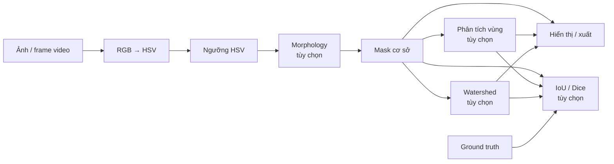

# Pipeline và kiến trúc

Tài liệu này dành cho người muốn hiểu luồng dữ liệu hoặc đóng góp mã nguồn.

## Pipeline xử lý

`baseline` là mask HSV sau morphology. Analysis và Watershed là hai nhánh độc lập nhận cùng
baseline. Khi đánh giá, người dùng phải chọn rõ target; target không khả dụng không được tự
động thay bằng baseline.

## Các lớp mã nguồn

| Layer | Trách nhiệm |
|---|---|
| `processing/` | Thuật toán thuần trên mảng NumPy; không đọc file, không phụ thuộc GUI |
| `io/` | Đọc ảnh/video, ground truth, xuất PNG và ghi experiment |
| `application/` | Session, playback, background worker và kiểm soát revision |
| `gui/` | Theme, controls, preview, histogram, dialog và controller Tk |

## Tính nhất quán khi xử lý nền

Mỗi request gắn với revision của nguồn, settings và ground truth. Kết quả hoàn thành muộn chỉ
được commit nếu các identity này vẫn khớp trạng thái hiện tại. Cơ chế này ngăn một tác vụ cũ
ghi đè kết quả mới khi người dùng chỉnh ngưỡng nhanh, đổi frame hoặc xóa ground truth.

Chi tiết hợp đồng và mô hình dữ liệu nằm trong
[`specs/002-object-separation-evaluation/`](../../specs/002-object-separation-evaluation/).
