# HSV experiment comparisons

Generated from the immutable records in `experiments/runs/`. Each row links the source,
binary mask, and segmented RGB output at source resolution. Selection percentages describe
mask coverage only; they are not accuracy measurements because no ground-truth labels exist.

The broad setting favors target recall and can admit similarly colored background. The narrow
setting favors color specificity and can miss shaded/desaturated target pixels. IMG-009 and
IMG-010 are the same real photographed scene under directional lights 0 and 24, providing a
controlled view of lighting-dependent HSV selection without treating synthetic edits as evidence.

| Input / setting | Original | Binary mask | Segmented result | Observation |
|---|---|---|---|---|
| IMG-001 / broad | 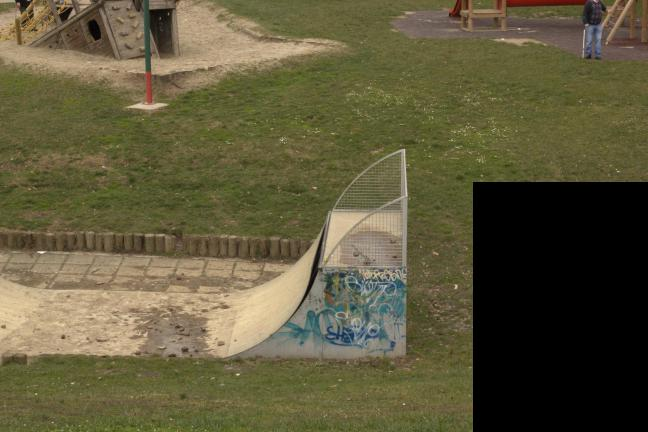 | 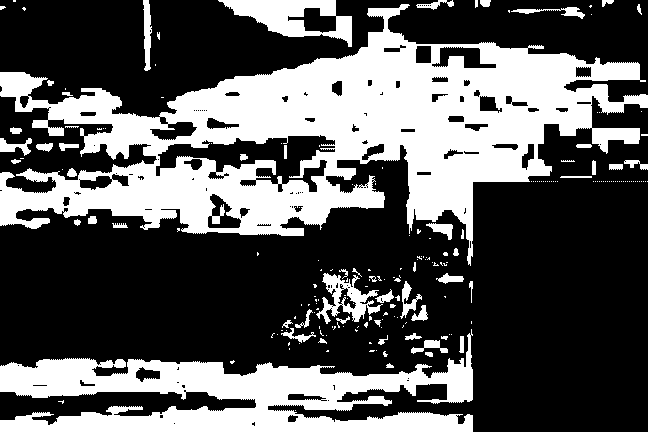 | 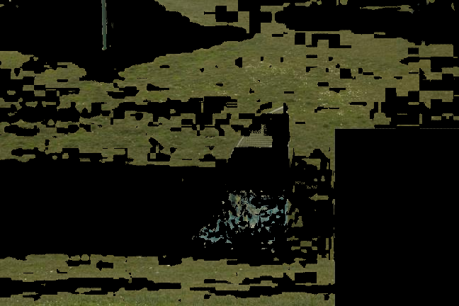 | Broad green interval selected 34.88% of pixels; it retains more shaded target colors but may include similarly colored background regions. No ground-truth accuracy is claimed. |
| IMG-001 / narrow |  | 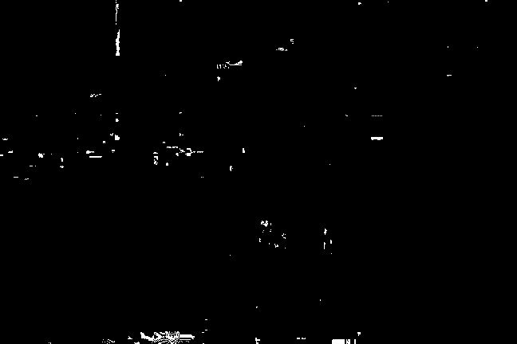 | 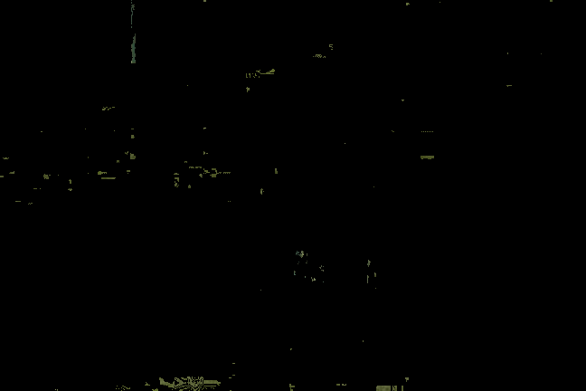 | Narrow green interval selected 0.58% of pixels; it reduces unwanted colors but may miss darker or less saturated target regions. No ground-truth accuracy is claimed. |
| IMG-002 / broad | 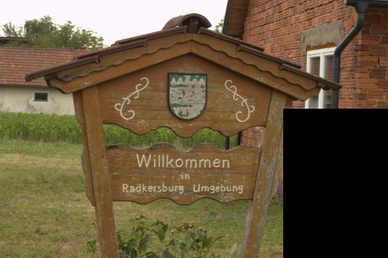 | 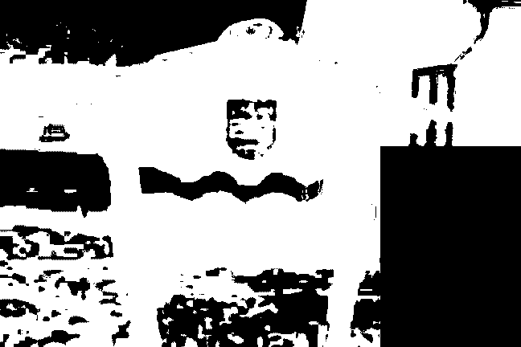 | 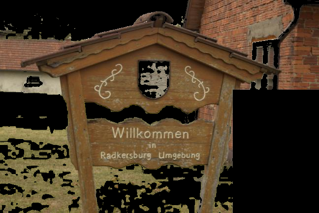 | Broad brown interval selected 61.06% of pixels; it retains more shaded target colors but may include similarly colored background regions. No ground-truth accuracy is claimed. |
| IMG-002 / narrow |  | 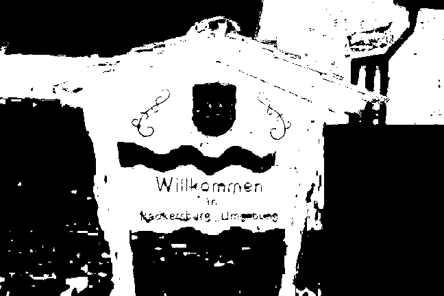 |  | Narrow brown interval selected 45.60% of pixels; it reduces unwanted colors but may miss darker or less saturated target regions. No ground-truth accuracy is claimed. |
| IMG-003 / broad | 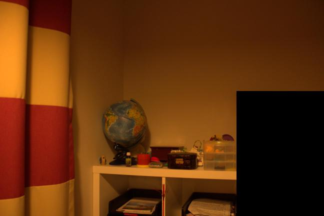 | 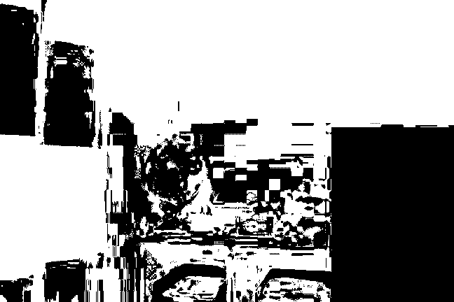 | 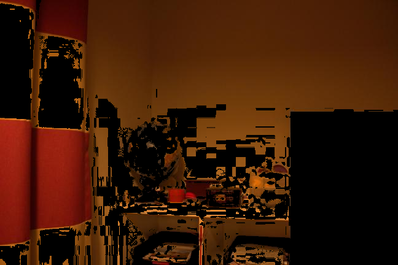 | Broad red interval selected 61.12% of pixels; it retains more shaded target colors but may include similarly colored background regions. No ground-truth accuracy is claimed. |
| IMG-003 / narrow |  | 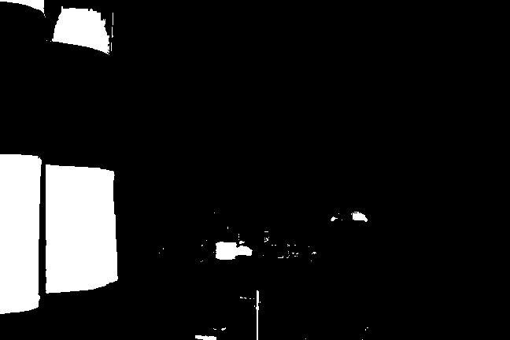 | 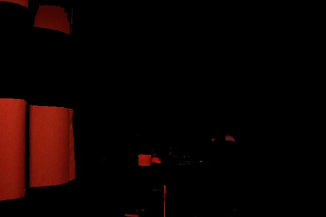 | Narrow red interval selected 10.19% of pixels; it reduces unwanted colors but may miss darker or less saturated target regions. No ground-truth accuracy is claimed. |
| IMG-004 / broad | 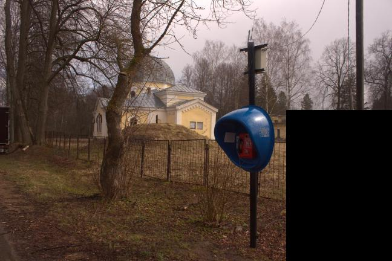 | 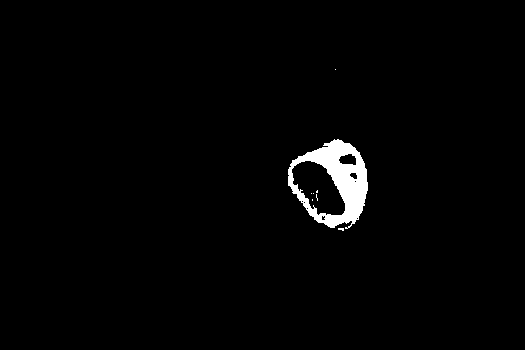 | 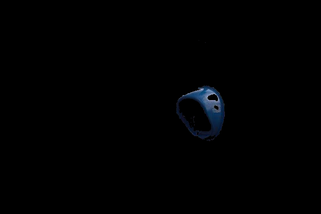 | Broad blue interval selected 1.75% of pixels; it retains more shaded target colors but may include similarly colored background regions. No ground-truth accuracy is claimed. |
| IMG-004 / narrow |  | 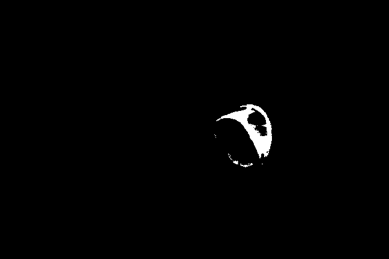 | 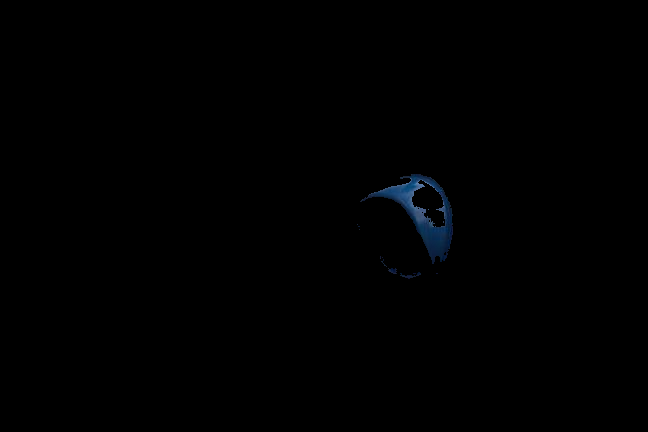 | Narrow blue interval selected 0.92% of pixels; it reduces unwanted colors but may miss darker or less saturated target regions. No ground-truth accuracy is claimed. |
| IMG-005 / broad | 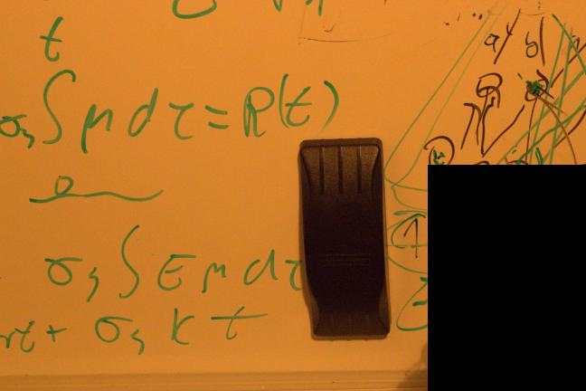 | 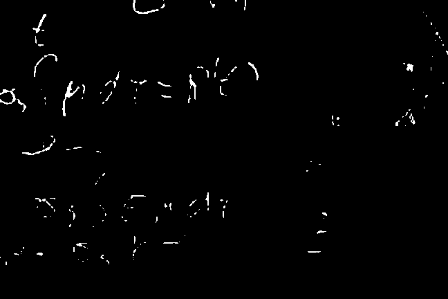 | 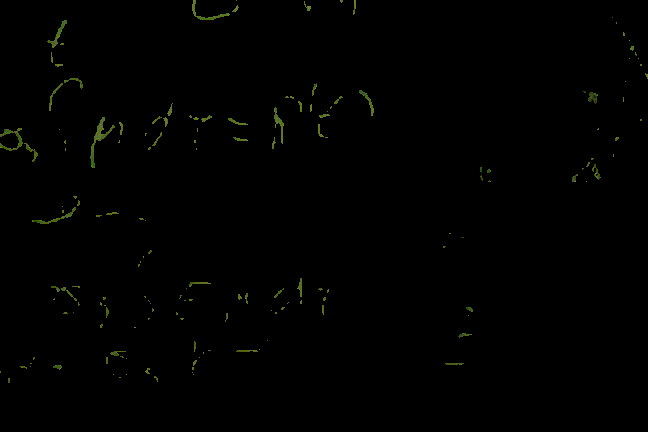 | Broad green interval selected 1.07% of pixels; it retains more shaded target colors but may include similarly colored background regions. No ground-truth accuracy is claimed. |
| IMG-005 / narrow |  | 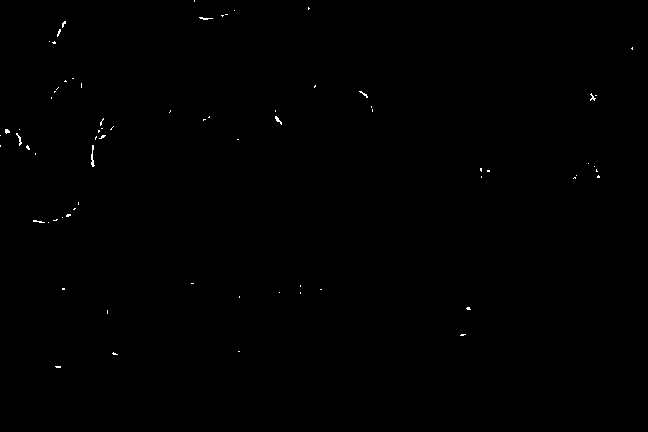 | 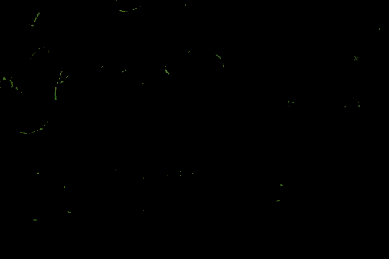 | Narrow green interval selected 0.17% of pixels; it reduces unwanted colors but may miss darker or less saturated target regions. No ground-truth accuracy is claimed. |
| IMG-006 / broad | 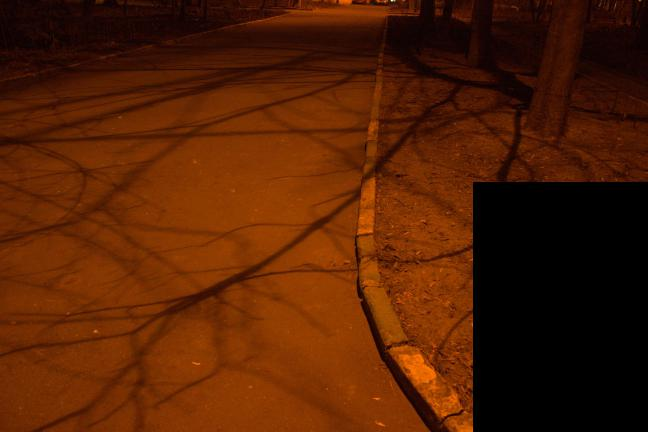 | 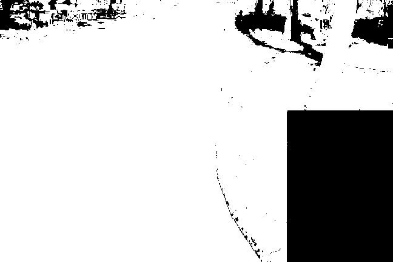 | 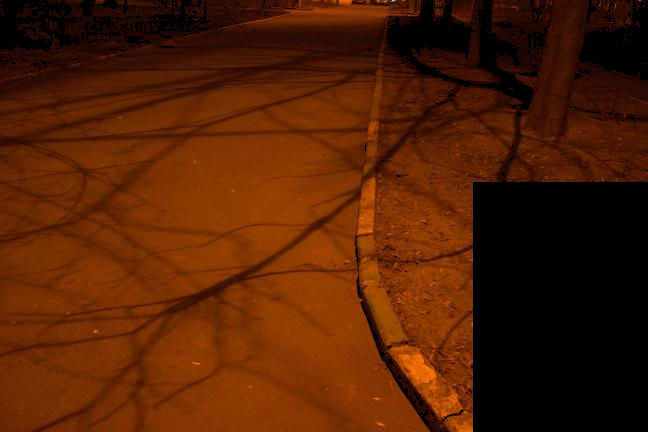 | Broad orange interval selected 79.50% of pixels; it retains more shaded target colors but may include similarly colored background regions. No ground-truth accuracy is claimed. |
| IMG-006 / narrow |  | 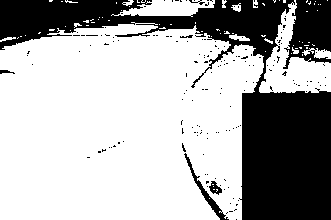 | 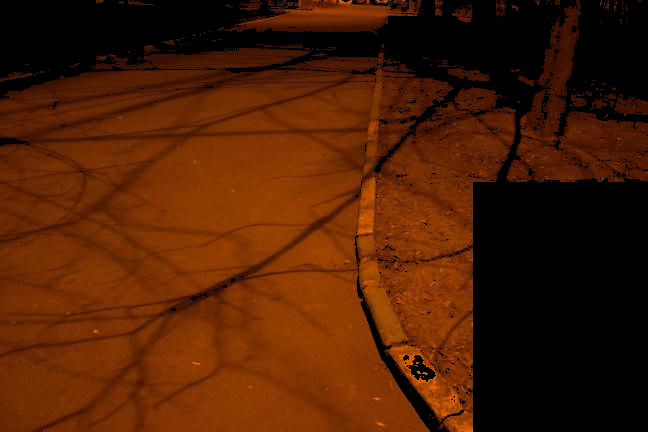 | Narrow orange interval selected 68.05% of pixels; it reduces unwanted colors but may miss darker or less saturated target regions. No ground-truth accuracy is claimed. |
| IMG-007 / broad | 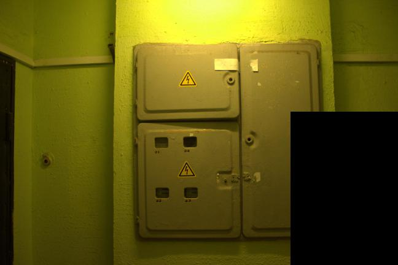 | 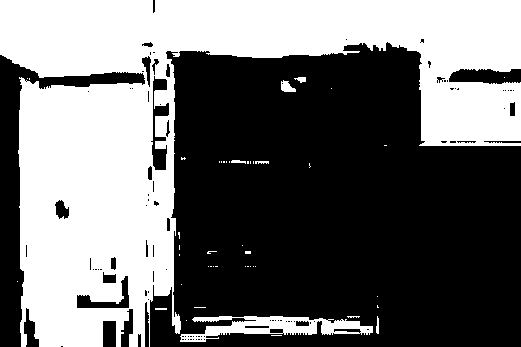 | 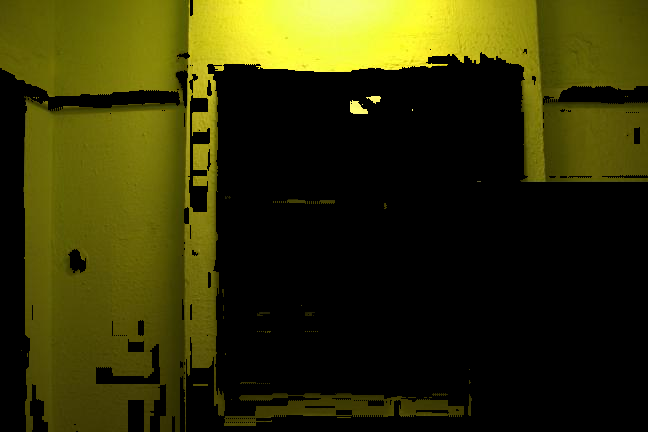 | Broad green interval selected 43.29% of pixels; it retains more shaded target colors but may include similarly colored background regions. No ground-truth accuracy is claimed. |
| IMG-007 / narrow |  |  |  | Narrow green interval selected 0.00% of pixels; it reduces unwanted colors but may miss darker or less saturated target regions. No ground-truth accuracy is claimed. |
| IMG-008 / broad | 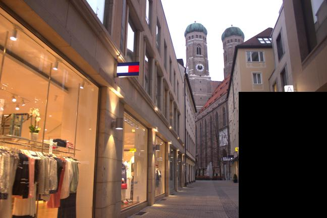 | 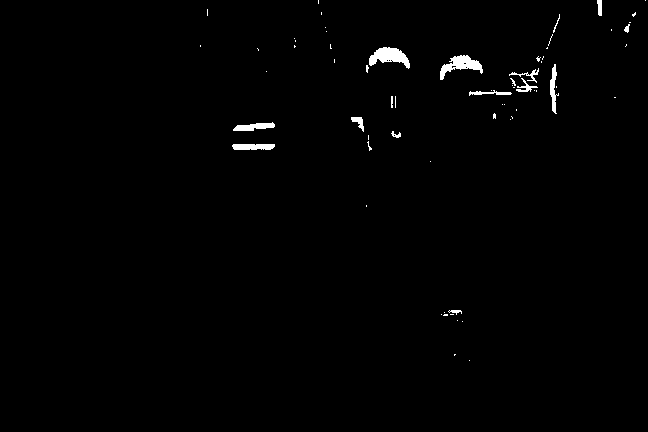 | 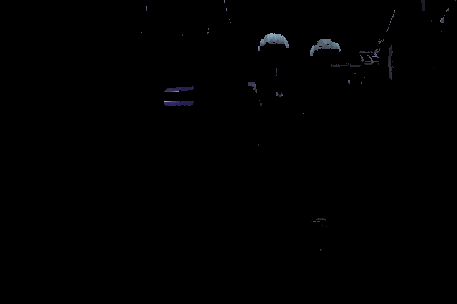 | Broad blue interval selected 0.89% of pixels; it retains more shaded target colors but may include similarly colored background regions. No ground-truth accuracy is claimed. |
| IMG-008 / narrow |  |  |  | Narrow blue interval selected 0.07% of pixels; it reduces unwanted colors but may miss darker or less saturated target regions. No ground-truth accuracy is claimed. |
| IMG-009 / broad | 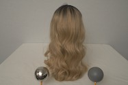 |  | 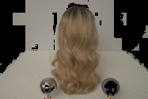 | Broad blond hair interval selected 76.80% of pixels; it retains more shaded target colors but may include similarly colored background regions. No ground-truth accuracy is claimed. |
| IMG-009 / narrow |  | 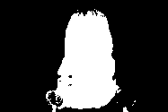 | 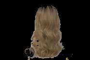 | Narrow blond hair interval selected 25.42% of pixels; it reduces unwanted colors but may miss darker or less saturated target regions. No ground-truth accuracy is claimed. |
| IMG-010 / broad | 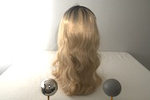 |  | 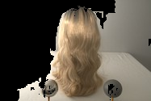 | Broad blond hair interval selected 62.55% of pixels; it retains more shaded target colors but may include similarly colored background regions. No ground-truth accuracy is claimed. |
| IMG-010 / narrow |  |  | 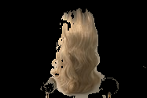 | Narrow blond hair interval selected 24.44% of pixels; it reduces unwanted colors but may miss darker or less saturated target regions. No ground-truth accuracy is claimed. |
